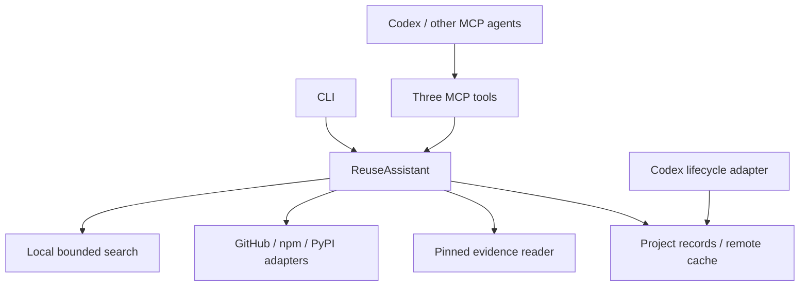

# Architecture

The shared core implements discovery, evidence retrieval and decisions. CLI and MCP are adapters to that interface; Codex lifecycle hooks read the same local records. The host agent supplies semantic judgment and performs actual integration and tests.

## Module interface

- `check(input)` normalizes the bounded query plan, searches fresh local code, queries/caches relevant public sources and merges repository/package identities. It preserves per-source failures. Up to eight local matches enter the merged shortlist so external candidates remain visible.
- `inspect(checkId, candidateId, paths)` resolves an existing candidate/alias, fetches fixed evidence and saves an inspection. It accepts up to five explicit paths and at most three distinct candidates per check. Inspection updates are serialized inside one core instance.
- `decide(input)` validates check/evidence identity, expiry, incomplete coverage acknowledgment and lifecycle transitions. Planned decisions require the original dependency context. Applied/verified decisions may include expected integration changes when linked to the correct preceding stage. Validation text is host-reported.

`Http` concentrates cancellation, response limits, public-host restrictions, selective authorization and bounded throttling retries. `Store` confines records to the configured project and writes JSON atomically. Source adapters and tests consume these interfaces rather than duplicating transport logic.

## Identity and evidence

Repository identity and distribution identity are different. Candidates from one GitHub repository can share a shortlist entry while retaining all package aliases and versions. Inspecting a package alias selects that exact distribution/version. Package names need not match repository or import names.

GitHub files use fixed commits. npm `gitHead`, when present with a matching repository, is preferred for the code reference; otherwise source/package correspondence is marked unverified. PyPI verification uses real distribution names from supplied or static project/installation evidence and reports repository association separately.

Source success means the finite query plan completed, not exhaustive recall. Local file/match limits and GitHub `incomplete_results` propagate as partial coverage. PyPI name verification is not full-text discovery.

## Client state

Codex `UserPromptSubmit` prepares a session/turn binding. The agent includes this binding in its check. A planned decision associates the check with that turn; `PreToolUse` on declared patch tool names reads that association. A new turn invalidates the old permit. Concurrent sessions have separate state files.

The adapter guards declared patch paths only. Arbitrary shell writes and existing interactive sessions are outside its enforcement. Host trust, callback coverage and callback timeout behavior remain host-owned. Tests can verify hook payloads and generated launcher behavior without proving activation in a live desktop session.

## Extension seams and limits

The initial source seam already has multiple adapters. Add language/package sources there; add client-specific configuration/trigger behavior beside `codex-hook.ts` and `install.ts`. Keep task, evidence and decision semantics in the shared core. Future clients can use standard MCP before a specialized lifecycle adapter exists.

Current limits include lexical local search, first-page public search results, no exhaustive recall guarantee, in-process rather than cross-process inspection update serialization, and host-reported semantic/validation claims. This is a local v0.1 implementation, not a multi-user coordination platform.
