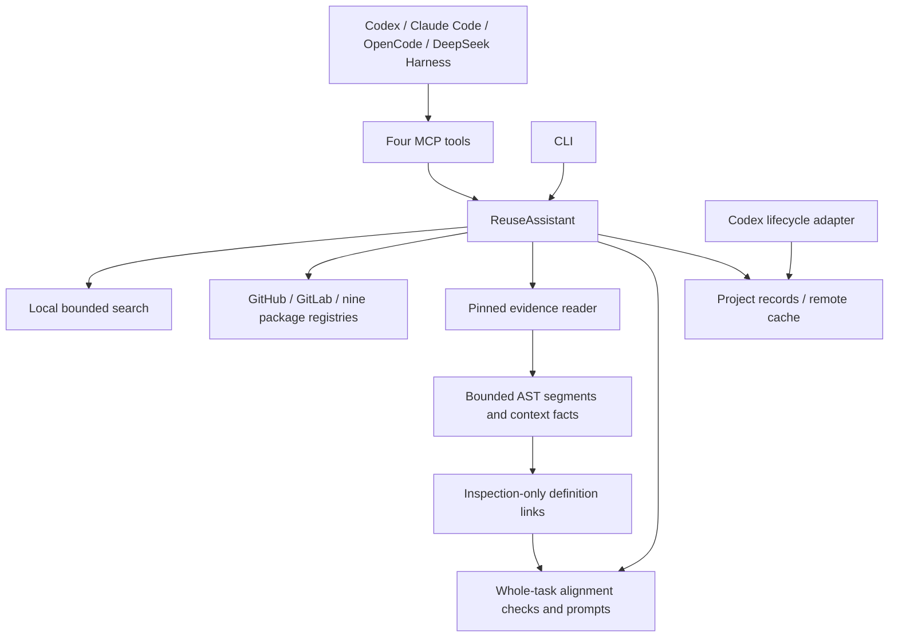

# Architecture

The shared core implements discovery, evidence retrieval and decisions. CLI and MCP are adapters to that interface; Codex lifecycle hooks read the same local records. Native setup adapters support Codex, Claude Code, OpenCode and DeepSeek Harness. The host agent supplies semantic judgment and performs actual integration and tests.

## Module interface

- `check(input)` normalizes the bounded query plan, searches fresh local code, queries/caches relevant public sources and merges repository/package identities. It preserves per-source failures. Up to eight local matches enter the merged shortlist so external candidates remain visible.
- `inspect(checkId, candidateId, paths)` resolves an existing candidate/alias, fetches fixed evidence and saves an inspection. It accepts up to five explicit paths and at most three distinct candidates per check. Inspection updates are serialized inside one core instance.
- `decide(input)` validates check/evidence identity, expiry, incomplete coverage acknowledgment and lifecycle transitions. Planned decisions require the original dependency context. Applied/verified decisions may include expected integration changes when linked to the correct preceding stage. Validation text is host-reported.
- `assess(input)` binds exact inspected segments to every task/constraint requirement, checks parent context and forbidden import rules, and requires baseline alternatives plus an integration plan. Its immutable report gates decisions for checks with an alignment contract; semantic claims are explicitly host-reported. Local evidence hashes are rechecked before a planned decision. Inspection/assessment updates share a serialized queue.

`segments.ts` owns static parsing, shared code-path recognition for adaptation decisions, and the shared evidence budgets. JS/TS retains the pinned Babel parser; `polyglot.ts` adapts fixed Tree-sitter WASM grammars for Python, Go, Rust, Java, C#, C, C++, PHP, Ruby, Kotlin, Swift, Bash and Lua, loaded from shipped assets without native toolchains or network fetches. Core inspection awaits initialization; parser/tree resources are released per file. `linking.ts` consumes fully traversed Babel evidence to associate relative imports, explicit exports and stable top-level direct calls inside one inspection. Foreign-language imports bypass JS path resolution and keep unsupported reasons; their calls remain unresolved. The linker never reads additional source or executes it. `alignment.ts` owns the contract, parent/callee/module closure, deterministic checks and task-specific prompt. CLI/MCP and the installed skill consume this shared behavior. Structural and linkage coverage are separate; unsupported languages, clipped/invalid code, unknown links and budgets flow into alignment gaps. See [alignment details](ALIGNMENT.md).

`Http` concentrates cancellation, response limits, public-host restrictions, selective authorization and bounded throttling retries. `Store` confines records to the configured project and writes JSON atomically. Source adapters and tests consume these interfaces rather than duplicating transport logic.

`pagination.ts` schedules discovery rounds with four workers and a shared signal. Source adapters read one page and expose progress; every first-page job finishes before any second page starts. The core defaults `maxPages` to two (allowed: one through three). The cap is part of cache/decision context; checks created before this field existed retain their original context hash. A continuation merges by candidate ID, retains successful pages on failure, preserves partial flags and stops repeated pages without claiming exhaustion. Failed/partial plans are not cached. Exact lookups do not request continuations. Successful finite plans may still have `hasMore: true` at the page cap.

Hex uses the same numbered-page transport and preserves fixed release metadata separately from mutable package metadata. pub.dev is a distinct `name_search` capability: core loads one official limited name corpus per check, persists it through the confined Store cache with an eight-hour TTL, and pages local literal matches. This cache is separate from six-hour remote query-result caching; public notes preserve corpus timestamps and scope. Cold checks in different processes can fetch independently. Neither source downloads or executes publisher archives. Registry code and CLI/MCP selection stay in the same shared core.

## Identity and evidence

Repository identity and distribution identity are different. Repository keys include their platform. Candidates from one GitHub/GitLab repository can share a shortlist entry while retaining all package aliases and versions. Inspecting a package alias selects that exact distribution/version. Package names need not match repository or import names.

GitHub/GitLab files use fixed commits. npm `gitHead` and Packagist `source.reference`, when supplied with a matching repository, link code to published metadata; otherwise correspondence remains unverified. New registry readers retain selected version metadata, NuGet discovered registration/catalog URLs and Maven POM text. Unsupported repository associations and missing code/license evidence remain partial. PyPI verification uses real distribution names from supplied or static project/installation evidence and reports repository association separately.

Source success means the finite query plan completed, not exhaustive recall. Local file/match limits and GitHub `incomplete_results` propagate as partial coverage. PyPI name verification is not full-text discovery.

## Client state

`clients.ts` owns explicit client selection, native configuration/skill/instruction installation, receipts, filesystem diagnostics and selective removal. It delegates existing Codex behavior to `install.ts`. It does not discover candidates or decide reuse. New clients use standard MCP and the shared skill without turn bindings or automatic write guards. Independent skill directories prevent cross-client uninstall. Installer paths reject symlinks/junctions before creating directories, preflight content conflicts, and retain user-modified generated content. Multi-file writes are not transactional.

`jsonc.ts` uses the fixed `jsonc-parser` dependency for syntax and range evidence. The OpenCode adapter accepts JSONC in the sole existing root `opencode.json` or `opencode.jsonc`, defaulting to `opencode.json` when neither exists. It rejects malformed syntax, duplicate decoded keys, conflicting sections, dual files and receipt-path changes before writes. Version 1 receipts retain the selected allowlisted filename and original ownership. Edits preserve unrelated values and surrounding comments; boundary whitespace can change and replacement can remove comments within the managed value. An equal entry leaves configuration text unchanged. These local file rules do not resolve OpenCode's global, ancestor, `.opencode` or runtime overrides, and `doctor` does not establish host activation. Discovery, evidence retrieval and reuse decisions remain in the shared core.

DeepSeek uses a generated Cordis `--patch` overlay with an `@deepseek-ai/dsh-mcp-client` row. Activation is explicit and process-scoped: its server always uses the configured project's records. No DSH home/profile files are edited. Filesystem `doctor` results never establish host loading, trust, or actual model compliance. See [client contracts](CLIENTS.md).

Codex `UserPromptSubmit` prepares a session/turn binding. The agent includes this binding in its check. A planned decision associates the check with that turn; `PreToolUse` on declared patch tool names reads that association. A new turn invalidates the old permit. Concurrent sessions have separate state files.

The adapter guards declared patch paths only. Arbitrary shell writes and existing interactive sessions are outside its enforcement. Host trust, callback coverage and callback timeout behavior remain host-owned. Tests can verify hook payloads and generated launcher behavior without proving activation in a live desktop session.

## Extension seams and limits

`catalog.ts` describes source capabilities and ecosystem routing; `sources.ts` handles repository adapters/merging and `registries.ts` handles registry discovery/evidence. `core.ts` owns selection, failures and cache context, using `pagination.ts` for bounded scheduling. CLI/MCP consume the same semantics. Client setup lives in `clients.ts`/`install.ts`, separately from the `codex-hook.ts` lifecycle adapter. See [current source limits](SOURCES.md) and the [long-term goal](ROADMAP.md).

Current limits include UTF-8 lexical local discovery, root-only dependency fingerprints, at most three offset/numbered search pages, mutable upstream totals/rankings, no exhaustive recall guarantee, pub discovery restricted to an official limited name corpus, in-process record-update serialization, structural parsing limited to JS/TS and thirteen WASM grammars, conservative JS/TS module-level definition links rather than a runtime call graph, optional alignment contracts for backward compatibility, and host-reported semantic/validation claims. New-language project/module/call resolution, preprocessing/compiler configuration, cursor traversal, more structural parsers, precise lexical/project resolution, runtime whole-system checks, automatic query translation, official fallback endpoints and selective failed-source retries remain future work. All-language/all-platform collection remains the long-term direction, with per-source progress made explicit.
